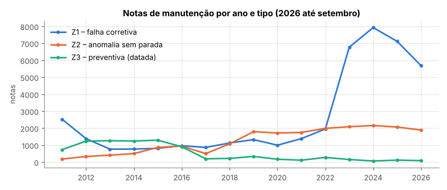
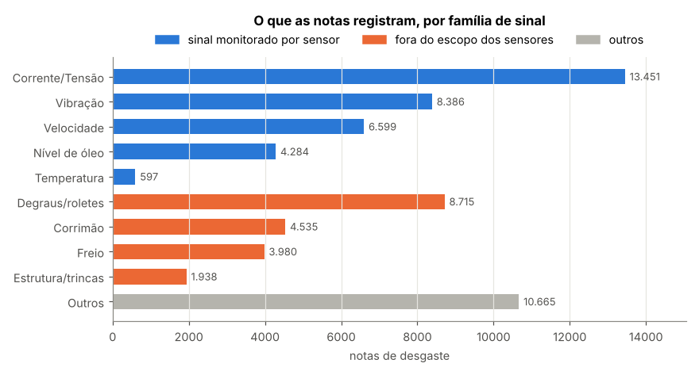
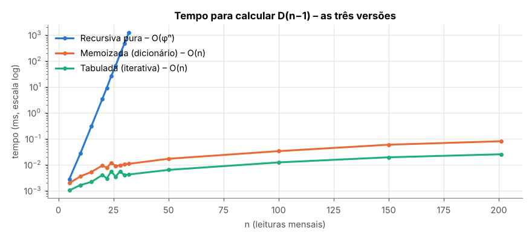
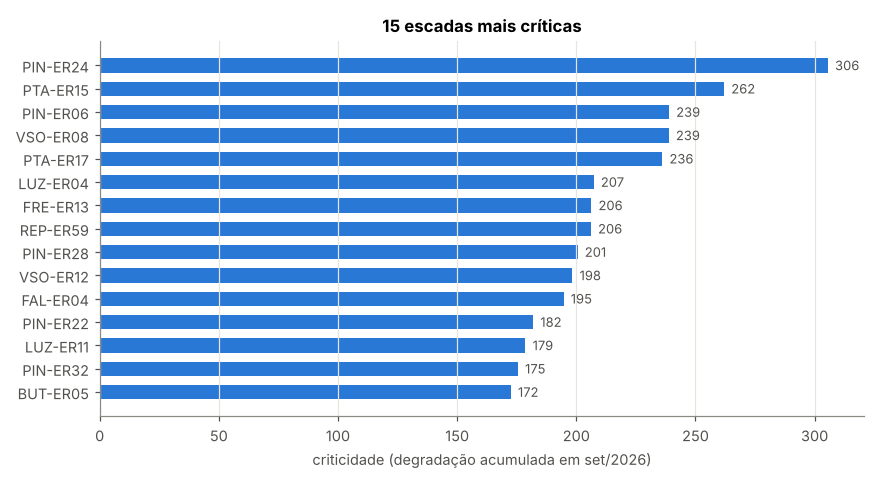
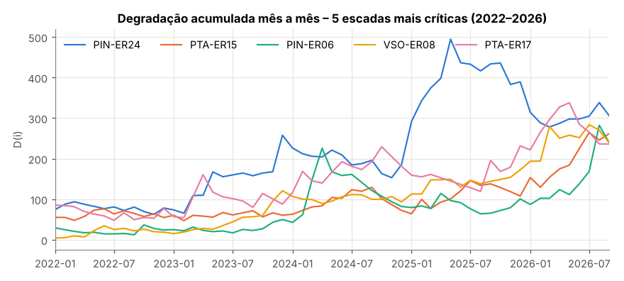
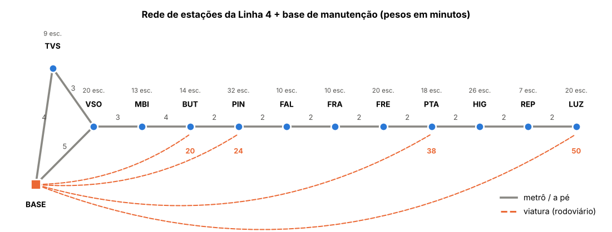
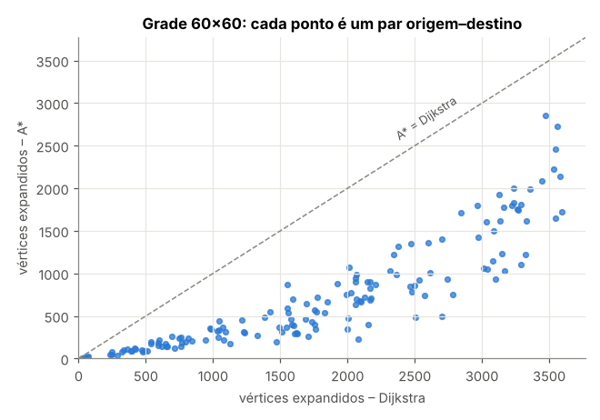

# Dynamic Programming e Grafos – Escadas rolantes da Linha 4 (Motiva)

Challenge FIAP × Motiva. O projeto calcula a **degradação acumulada** de cada escada rolante da Linha 4-Amarela com
programação dinâmica e gera o **ranking de criticidade**. Ele modela a **rede de estações como grafo** (BFS, Dijkstra e A\*)
e monta o **plano de manutenção do turno** com `planejar_turno(base, horas)`.

O notebook [`notebook.ipynb`](notebook.ipynb) já está executado e roda de ponta a ponta em cerca de 15 segundos.

## Contexto do desafio

A Motiva (antigo Grupo CCR) opera a Linha 4-Amarela pela ViaQuatro, com **197 escadas rolantes** atendidas por
**4 grupos de manutenção** (críticas e não críticas). Hoje a preventiva segue **calendário** (planos P1, P6, P9…) e
trata igualmente escadas com usos e desgastes muito diferentes. O desafio pede manutenção **orientada por dados**.
Este projeto responde a duas das perguntas do desafio:

| Pergunta do desafio | Como o projeto responde |
|---|---|
| Quais equipamentos merecem maior atenção e prioridade? | Ranking de criticidade por degradação acumulada, com as escadas separadas em **Crítica** e **Não crítica** |
| Como transformar essas informações em apoio à priorização? | `planejar_turno(base, horas)`: escadas, ordem e rota do turno |

---

## Sumário

0. [Contexto do desafio](#contexto-do-desafio)
1. [Como executar](#como-executar)
2. [Estrutura do repositório](#estrutura-do-repositório)
3. [Dados](#dados)
4. [Degradação acumulada – três versões](#degradação-acumulada--três-versões)
5. [Ranking de criticidade](#ranking-de-criticidade)
6. [Rede de estações: BFS e Dijkstra](#rede-de-estações-bfs-e-dijkstra)
7. [A\* com heurística justificada](#a-com-heurística-justificada)
8. [Plano de manutenção – `planejar_turno`](#plano-de-manutenção--planejar_turno)
9. [Conclusões e limitações](#conclusões-e-limitações)
10. [Referência das funções](#referência-das-funções)

---

## Como executar

```bash
pip install -r requirements.txt
jupyter notebook notebook.ipynb          # ou: jupyter nbconvert --to notebook --execute notebook.ipynb
```

O plano do turno também pode ser chamado direto do Python. Grafo, ranking e tempos de reparo são carregados de `data/`:

```python
from src.planejamento import planejar_turno, exibir_plano
exibir_plano(planejar_turno("BASE", 8))
```

Para regenerar os CSVs a partir das exportações brutas do SAP (`ecr_AAAA.XLSX`, fora do repositório por tamanho):

```bash
python scripts/preparar_dados.py <pasta_com_os_xlsx>
```

## Estrutura do repositório

```
├── notebook.ipynb              # experimento completo, executado
├── data/
│   ├── eventos_escadas.csv     # 71.966 notas de manutenção datadas (dataset)
│   ├── escadas.csv             # 199 escadas e a estação de cada uma
│   ├── rede.json               # rede de estações: vértices, coordenadas, arestas (minutos)
│   └── ranking_criticidade.csv # saída do notebook
├── src/
│   ├── degradacao.py           # dano por evento, 3 versões da recorrência, ranking
│   ├── sinais.py               # liga cada nota ao sinal de sensor (ou item fora do escopo)
│   ├── grafo.py                # lista de adjacência, BFS, Dijkstra, A*, reconstrução de rota
│   └── planejamento.py         # planejar_turno (mochila por programação dinâmica + rotas)
├── scripts/preparar_dados.py   # limpeza das exportações do SAP
└── figs/                       # gráficos gerados pelo notebook
```

## Dados

> **Adaptação importante.** O enunciado cita sensores (vibração, temperatura, corrente/tensão, nível de óleo e
> velocidade), mas o dataset fornecido pela Motiva é o histórico de **notas de manutenção do SAP** das escadas
> rolantes da Linha 4, de 2009 a set/2026. Não há telemetria. Cada nota datada é tratada como uma **leitura** do
> estado da escada, e o dano de cada leitura é calculado com campos reais da nota. Além disso, cada nota é ligada ao
> sinal de sensor que teria detectado o problema (ver [Das notas aos sinais](#das-notas-aos-sinais-monitorados)).
> Se houver telemetria, basta trocar a função `dano_evento`; o restante do pipeline não muda.

**Limpeza** (`scripts/preparar_dados.py`): de 104.119 linhas brutas, foram removidas 2.585 notas duplicadas,
680 sem escada identificada e 4.912 canceladas ou duplicadas no SAP. Notas sem data de avaria (preventivas Z3
sem apontamento) ficam fora. A duração da avaria só é aceita entre 0 e 30 dias. Resultado: **71.966 eventos,
199 escadas, 12 estações**.

| Tipo de nota | Significado (inferido do conteúdo) | Peso no dano |
|---|---|---|
| Z1 | Falha corretiva – 85 % deixam a escada indisponível | 2 |
| Z7 | Reparo de componente estrutural (tramo, degrau) | 1,5 |
| Z2 | Anomalia sem parada (ruído, óleo baixo, velocidade) | 1 |
| Z3, Z8, Z9 | Preventiva, melhoria, serviço | 0 (não é desgaste) |



**Interpretação.** As falhas Z1 saltam de 1.956 em 2022 para 6.778 em 2023. Não é um aumento real de quebras:
a partir de 2023, 77 % das Z1 têm a descrição padronizada *Falha Técnica* e 65 % são resolvidas com
*resetado e testado*. Ou seja, as paradas curtas passaram a ser registradas automaticamente. O valor absoluto da
degradação é maior depois de 2023, mas o ranking compara todas as escadas **no mesmo mês**, sob o mesmo regime de
registro, então continua justo.

### Das notas aos sinais monitorados

`src/sinais.py` classifica cada nota na família de sinal que a descreve, lendo os campos em ordem de evidência
(sintoma → defeito → causa → objeto → descrição). As famílias são os **cinco sinais monitorados** do desafio e os
**quatro itens que o desafio declara fora do escopo dos sensores**.

| Grupo | Família | Notas | % | Exemplos de sintoma |
|---|---|---:|---:|---|
| Sensor | Corrente/Tensão | 13.451 | 21,3 | mau contato, não liga, linha de segurança |
| Sensor | Vibração | 8.386 | 13,3 | folga anormal, ruído anormal, corrente principal |
| Sensor | Velocidade | 6.599 | 10,4 | travado, alarme de sub/sobrevelocidade |
| Sensor | Nível de óleo | 4.284 | 6,8 | alarme da bomba de lubrificação, vazamento |
| Sensor | Temperatura | 597 | 0,9 | alarme térmico do motor |
| Fora do escopo | Degraus/roletes | 8.715 | 13,8 | quebra/falta de degrau, roletes |
| Fora do escopo | Corrimão | 4.535 | 7,2 | entrada e velocidade de corrimão |
| Fora do escopo | Freio | 3.980 | 6,3 | bloqueio e desgaste de freio |
| Fora do escopo | Estrutura/trincas | 1.938 | 3,1 | trincado, deformação, ruptura |
| — | Outros | 10.665 | 16,9 | placa pente, rodapé, vandalismo, iluminação |



**Interpretação.** Das 63.150 notas de desgaste, **52,8 %** descrevem problemas que um dos cinco sinais monitorados
teria captado, e **30,4 %** caem nos itens fora do escopo dos sensores. Essa é a **observação dos dados**. A
**hipótese técnica** que decorre dela é que o histórico de notas deve complementar a telemetria, não ser substituído
por ela. Sensores de freio e de corrimão seriam os próximos candidatos.

## Degradação acumulada – três versões

**Dano de cada evento:**

```
dano = peso_tipo + 2·indisponível + 1·falha + min(ln(1 + horas paradas), 3) + ajuste_defeito
```

O `ajuste_defeito` vale +1 para defeitos graves (quebrado, danificado, desgastado, travamento…) e −0,5 para
"nada constatado". Os danos são somados por mês e por escada, formando as leituras `d[0..n-1]`
(jan/2010 a set/2026, **n = 201**).

**Recorrência** – o dano novo mais uma fração do desgaste dos dois meses anteriores (a manutenção recupera o resto):

```
D(i) = d[i] + a·D(i-1) + b·D(i-2),   D(-1) = D(-2) = 0,   a = 0,6  b = 0,2
```

Com `a + b < 1`, o desgaste antigo é esquecido aos poucos (meia-vida de cerca de 4 meses). Os **dois** termos
recursivos fazem a recursão pura repetir subproblemas em número exponencial, que é o caso clássico para
programação dinâmica.

| Versão | Função | Complexidade |
|---|---|---|
| Recursiva pura | `degradacao_recursiva` | O(φⁿ) chamadas |
| Recursiva memoizada (dicionário) | `degradacao_memoizada` | O(n) |
| Iterativa com tabulação | `degradacao_tabulada` | O(n), sem recursão |

**Resultado:** as três versões dão **exatamente o mesmo valor** em todas as 198 escadas com eventos de desgaste
(diferença 0,0).

| n (leituras) | Recursiva pura | Memoizada | Tabulada | Chamadas (pura) | Chamadas (memo) |
|---:|---:|---:|---:|---:|---:|
| 10 | 0,019 ms | 0,003 ms | 0,001 ms | 287 | 21 |
| 20 | 2,3 ms | 0,005 ms | 0,002 ms | 35.421 | 41 |
| 28 | 117 ms | 0,007 ms | 0,002 ms | 1.664.079 | 57 |
| 32 | 646 ms | 0,006 ms | 0,002 ms | 11.405.773 | 65 |
| 201 | inviável (~10²⁷ anos) | 0,041 ms | 0,013 ms | ~2,4 × 10⁴² | 403 |

*Tempos de uma execução; variam um pouco entre máquinas e rodadas, mas a ordem de grandeza se mantém.*



**Interpretação.** O custo da recursão pura cresce como Fibonacci: cada leitura a mais multiplica as chamadas por
**1,618 (φ)**, valor medido no notebook. Em n = 32 a memoizada é cerca de 100 mil vezes mais rápida e a tabulada
cerca de 300 mil vezes. Na série completa (201 meses) a pura é inviável. A tabulada é cerca de 3× mais rápida que a
memoizada, porque não paga chamadas de função nem consultas ao dicionário, e não corre risco de estourar a pilha.
É a versão usada no ranking.

## Ranking de criticidade

A criticidade é `D(n-1)`, a degradação acumulada na última leitura (set/2026). Para alinhar com os grupos de
manutenção da Motiva, o quartil superior (criticidade ≥ 114,7) forma a classe **Crítica**, com 50 escadas, e as
outras 148 ficam como **Não crítica**. A lista completa está em `data/ranking_criticidade.csv`.

| # | Escada | Estação | Criticidade | Classe | Eventos 12 m | Falhas Z1 12 m | Horas paradas 12 m | Sinal predominante |
|---:|---|---|---:|---|---:|---:|---:|---|
| 1 | PIN-ER24 | Pinheiros | 305,6 | Crítica | 157 | 122 | 281 | Corrente/Tensão |
| 2 | PTA-ER15 | Paulista | 262,0 | Crítica | 115 | 81 | 491 | Corrente/Tensão |
| 3 | PIN-ER06 | Pinheiros | 238,9 | Crítica | 100 | 89 | 151 | Degraus/roletes |
| 4 | VSO-ER08 | Vila Sônia | 238,8 | Crítica | 145 | 130 | 116 | Corrente/Tensão |
| 5 | PTA-ER17 | Paulista | 236,1 | Crítica | 147 | 117 | 252 | Corrente/Tensão |
| 6 | LUZ-ER04 | Luz | 207,3 | Crítica | 152 | 135 | 159 | Corrente/Tensão |
| 7 | FRE-ER13 | Oscar Freire | 206,3 | Crítica | 110 | 102 | 387 | Corrente/Tensão |
| 8 | REP-ER59 | República | 206,1 | Crítica | 115 | 93 | 144 | Corrente/Tensão |
| 9 | PIN-ER28 | Pinheiros | 200,6 | Crítica | 138 | 129 | 259 | Corrente/Tensão |
| 10 | VSO-ER12 | Vila Sônia | 198,4 | Crítica | 108 | 90 | 175 | Corrente/Tensão |

| Escadas críticas por estação | PIN | LUZ | BUT | PTA | FAL | FRE | VSO | MBI | REP | HIG | FRA | TVS |
|---|---:|---:|---:|---:|---:|---:|---:|---:|---:|---:|---:|---:|
| Crítica / total | 13/32 | 8/20 | 6/14 | 5/18 | 4/10 | 3/20 | 3/20 | 3/13 | 3/6 | 2/26 | 0/10 | 0/9 |




**Interpretação.** A **PIN-ER24** lidera, com 122 falhas corretivas em 12 meses. A **PTA-ER15** tem a maior
indisponibilidade do topo (491 horas paradas). Pinheiros concentra 8 das 30 escadas mais críticas, o que é coerente
com ser a maior estação (32 escadas) e um ponto de integração com a CPTM. A série mês a mês mostra que o modelo
reage a pioras recentes: a PIN-ER24 teve pico em 2025 e vem caindo, enquanto VSO-ER08 e PIN-ER06 subiram em 2026.

**Grupos e sinais.** Pinheiros tem 13 de 32 escadas no grupo crítico. Higienópolis, com 26 escadas, tem só 2, então
o número de escadas da estação não explica sozinho a criticidade. O sinal predominante dos últimos 12 meses é
corrente/tensão em 43 das 50 críticas, o que reflete as falhas de linha de segurança resolvidas com reset que
dominam o registro desde 2023. Nas outras 7 críticas predominam degraus/roletes, um item fora do escopo dos sensores.

**Sensibilidade.** Com (a, b) = (0,3; 0,1) ou (0,8; 0,15), 12 a 13 das 20 primeiras continuam no top 20, e a
correlação de Spearman com o ranking padrão fica entre 0,85 e 0,93. O grupo do topo é robusto; as posições
intermediárias dependem de quanto se quer pesar o passado.

## Rede de estações: BFS e Dijkstra

`data/rede.json` modela **12 estações da Linha 4** e **1 base de manutenção** (Pátio Vila Sônia). O grafo é guardado
como **lista de adjacência** (`Grafo.adj`), e cada uma das 199 escadas está ligada à sua estação (`Grafo.escadas`).
Os pesos são minutos de deslocamento da equipe: metrô entre vizinhas, acesso a pé a partir do pátio e quatro
ligações por viatura (base → Butantã, Pinheiros, Paulista e Luz).

> Tempos e coordenadas são **estimativas** para fins acadêmicos, não dados oficiais da operadora.
> FRE = Oscar Freire e TVS = Terminal Vila Sônia são suposições sobre os códigos do SAP.



| Destino | BFS: trechos / min | Dijkstra: trechos / min | Rota Dijkstra |
|---|---|---|---|
| BUT | 1 / 20 | 3 / 12 | BASE → VSO → MBI → BUT |
| PIN | 1 / 24 | 4 / 14 | BASE → VSO → MBI → BUT → PIN |
| FRE | 2 / 40 | 7 / 20 | BASE → VSO → … → FRA → FRE |
| PTA | 1 / 38 | 8 / 22 | BASE → VSO → … → FRE → PTA |
| REP | 2 / 52 | 10 / 26 | BASE → VSO → … → HIG → REP |
| LUZ | 1 / 50 | 11 / 28 | BASE → VSO → … → REP → LUZ |

A tabela completa, com as 12 rotas reconstruídas, está no notebook.

**Interpretação.** O BFS minimiza **trechos** e escolhe a viatura: até a Luz, 1 trecho e 50 minutos. O Dijkstra
minimiza **tempo** e vai de metrô: 11 trechos e 28 minutos. O caminho de menos trechos custa de 8 a 26 minutos a mais.
Para a equipe de manutenção o critério é tempo, então o plano do turno usa o Dijkstra. O BFS faz sentido quando o
custo real é o número de transferências.

## A\* com heurística justificada

**Heurística:** `h(n) = distância_em_linha_reta(n, destino) / v_max`, em minutos, com
`v_max = max(distância_reta(u, v) / minutos(u, v))` sobre todas as arestas (0,677 km/min).

- **Admissível:** nenhum caminho é mais curto que a linha reta e nenhum trecho é mais rápido que `v_max`.
  Assim `h` nunca superestima, e o A\* devolve o caminho ótimo.
- **Consistente:** pela desigualdade triangular, `h(u) ≤ reta(u,v)/v_max + h(v) ≤ w(u,v) + h(v)`.
- **Verificação numérica:** 0 violações de admissibilidade e de consistência em todos os pares de vértices.

| Rede | Pares | Custo igual ao Dijkstra | Expandidos Dijkstra | Expandidos A\* | Redução |
|---|---:|---|---:|---:|---:|
| Linha 4 (13 vértices) | 12 | sim | 7,5 | 7,5 | 0 % |
| Grade sintética 60 × 60 (3.600 vértices) | 150 | sim | 1.810 | 728 | **60 %** |



**Interpretação.** Na rede real o A\* não poda nada: o grafo é praticamente uma linha, com um único caminho bom até
cada estação. Ele fica 2 a 2,5× mais lento, porque calcula a heurística a cada vizinho. Na grade de 3.600 vértices,
com muitos caminhos alternativos, ele expande 60 % menos vértices e roda cerca de 17 % mais rápido; o ganho de tempo
é menor que o de expansões por causa do custo da heurística. Para a Linha 4 o Dijkstra basta; o A\* passa a valer a
pena com uma rede maior, como várias linhas da Motiva ou a malha viária completa das viaturas.

## Plano de manutenção – `planejar_turno`

`planejar_turno(base, horas)` funciona assim:

1. Pega as **40 escadas mais críticas** do ranking como candidatas.
2. Estima o **tempo de reparo** de cada uma: mediana das falhas com indisponibilidade nos últimos 24 meses
   (limitada a 20–240 min), mais 10 min de acesso interno.
3. Resolve uma **mochila por grupos com programação dinâmica**. Cada estação é um grupo e a opção *k* é atender as
   *k* escadas mais críticas dali. O custo é a ida e volta da base (Dijkstra) mais os reparos; o valor é a soma das
   criticidades. A DP maximiza a criticidade atendida sem passar de `horas × 60` minutos.
4. Monta a **rota real**: estações em ordem de vizinho mais próximo, caminhos reconstruídos pelo Dijkstra e volta à base.
5. **Refina** o plano: a folga entre o custo conservador da mochila e a rota real é usada para incluir mais escadas críticas.

Exemplo – turno de 8 h saindo da base às 07:00:

```
 1. 07:05  Vila Sônia (VSO)  +5 min  rota: BASE → VSO
      07:05  VSO-ER08  criticidade 238.79   reparo  38 min
      07:43  VSO-ER12  criticidade 198.37   reparo  47 min
 2. 08:37  Butantã (BUT)  +7 min  rota: VSO → MBI → BUT
      08:37  BUT-ER05 · 09:13 BUT-ER06 · 09:44 BUT-ER08
 3. 10:16  Pinheiros (PIN)  +2 min  rota: BUT → PIN
      10:16  PIN-ER24 · 10:52 PIN-ER06 · 11:33 PIN-ER28
 4. 12:11  Paulista (PTA)  +8 min  rota: PIN → FAL → FRA → FRE → PTA
      12:11  PTA-ER15 · 13:01 PTA-ER17
 5. 13:37  Luz (LUZ)  +6 min  rota: PTA → HIG → REP → LUZ
      13:37  LUZ-ER04
    14:35  retorno à base  +28 min
Escadas atendidas: 11 | tempo usado: 455 de 480 min (deslocamento 56, reparo 399)
```

| Turno | Escadas | Estações | Tempo usado | Deslocamento | Posições no ranking atendidas |
|---|---:|---:|---|---:|---|
| 4 h | 5 | 2 | 220 / 240 min | 28 min | 1, 3, 4, 9, 10 |
| 8 h | 11 | 5 | 455 / 480 min | 56 min | 1–6, 9, 10, 15, 20, 26 |
| 12 h | 18 | 7 | 696 / 720 min | 56 min | 1–9, 13, 15–17, 20, 23, 26–28 |

**Interpretação.** O plano nunca passa do turno e prioriza o topo do ranking. Em 4 h atende 5 escadas entre as 10
mais críticas, concentradas perto da base; em 8 h chega a Paulista e Luz e cobre as 6 primeiras. O deslocamento
consome só 28 a 56 minutos. Nem sempre a ordem do ranking é seguida à risca: em 12 h a VSO-ER12 (10ª, com 47 min de
reparo) sai, e entram escadas com reparos mais curtos. É a mochila maximizando a criticidade **total** atendida no
tempo disponível.

## Conclusões e limitações

1. **Programação dinâmica é indispensável:** a recursão pura é exponencial (×1,618 por leitura). Memoização e
   tabulação resolvem 198 escadas × 201 meses em milissegundos, com o mesmo resultado.
2. **Manutenção por dados em vez de calendário:** o ranking separa 50 escadas críticas de 148 não críticas.
   Pinheiros (13), Luz (8) e Butantã (6) concentram o grupo crítico; a PIN-ER24 lidera.
3. **Dijkstra é o algoritmo certo para a equipe:** o BFS economiza trechos, mas custa até 26 minutos a mais.
4. **O A\* é correto, mas só compensa em redes maiores:** na Linha 4 não poda nada; numa malha de 3.600 vértices
   expande 60 % menos.
5. **`planejar_turno` integra tudo:** ranking como valor, Dijkstra como custo e mochila por DP para escolher as escadas.
6. **Sensores e notas se complementam:** 53 % do desgaste registrado seria captado pelos cinco sinais monitorados,
   e 30 % está em itens fora do escopo dos sensores (degraus/roletes, corrimão, freio, trincas).

**Limitações.** Os dados são notas de manutenção, não sensores. Os pesos do dano e os coeficientes `a` e `b` são
escolhas de modelagem, com sensibilidade analisada no notebook. Os tempos da rede são estimados. O plano supõe
uma única equipe. A mudança no registro de falhas em 2023 recomenda recalibrar os pesos usando apenas esse período.

## Referência das funções

| Módulo | Função | O que faz |
|---|---|---|
| `degradacao` | `dano_evento(tipo, indisponivel, falha, duracao_min, defeito)` | Dano de uma nota |
| | `leituras_mensais(eventos)` | Matriz escada × mês com os danos somados |
| | `degradacao_recursiva(danos, i)` | D(i) por recursão pura (com contador de chamadas) |
| | `degradacao_memoizada(danos, i, memo)` | D(i) com memo em dicionário |
| | `degradacao_tabulada(danos, serie=False)` | D(n−1) ou a série completa, por tabulação |
| | `ranking_criticidade(leituras, eventos, escadas, a, b)` | Ranking das escadas, com classe Crítica/Não crítica |
| `sinais` | `classificar_nota(nota)` | Família de sinal de uma nota (sensor ou fora do escopo) |
| | `adicionar_sinal(eventos)` | Acrescenta as colunas `sinal` e `grupo_sinal` |
| | `sinal_predominante(eventos)` | Sinal mais frequente de cada escada nos últimos 12 meses |
| `grafo` | `carregar_rede(json, escadas)` | Monta o grafo (lista de adjacência) e liga as escadas às estações |
| | `bfs(g, origem)` | Menor número de trechos |
| | `dijkstra(g, origem, destino=None)` | Menor tempo (árvore inteira ou ponto a ponto) |
| | `a_estrela(g, origem, destino, h)` | A\* com heurística |
| | `heuristica_tempo(g, destino)` | `h(n) = reta / v_max` |
| | `reconstruir_rota(pred, origem, destino)` | Caminho a partir dos predecessores |
| `planejamento` | `planejar_turno(base, horas)` | Plano do turno: escadas, ordem e caminhos |
| | `exibir_plano(plano)` | Imprime o plano como agenda |
